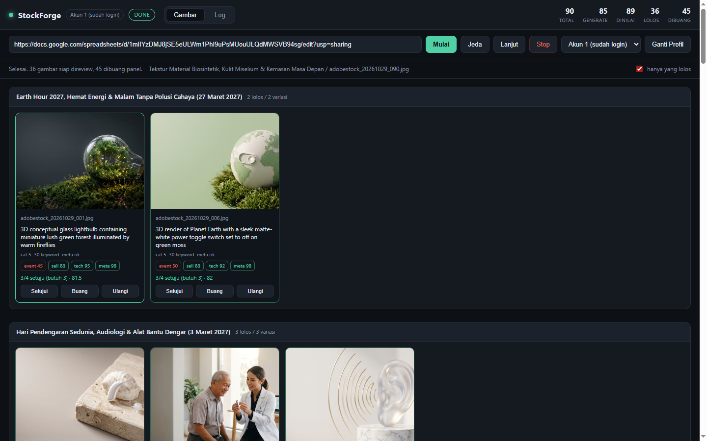
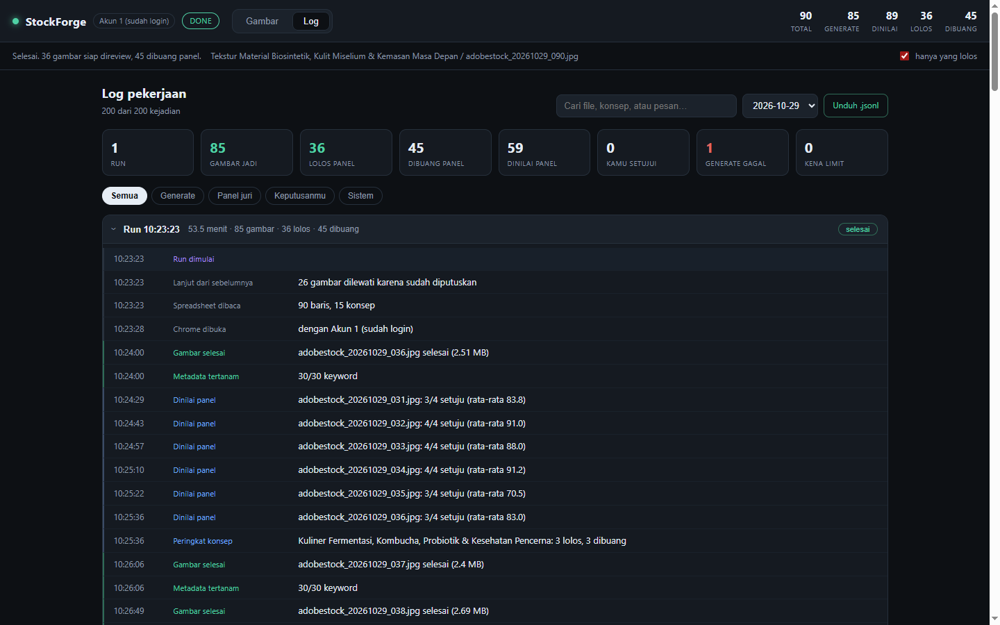

# StockForge

**Language:** [Indonesia](README.md) · English

A daily automation pipeline for Adobe Stock: read image prompts from Google Sheets, generate the images
in Gemini Web through a Chrome profile that is already signed in, embed the title and keywords straight
into the files, then filter everything with a panel of four AI judges. Whatever passes shows up on a
dashboard for you to approve and upload manually.

To keep building on this project, read [`docs/DEVELOPER.md`](docs/DEVELOPER.md) — code map, API, recipes
for adding features, and the list of pitfalls (the document itself is in Indonesian).

## Example output

A real card from a run: passed **4 of 4 judges**, average score **93**.


`adobestock_20261029_085.jpg` · category 8 · 30 keywords embedded in the file.

| Judge | Score | Verdict |
|---|---|---|
| Event legibility | 95 | pass |
| Commercial usability | 85 | pass |
| Technical & compliance | 94 | pass |
| Metadata match | 98 | pass |

The title embedded into XMP/IPTC (this is what Adobe Stock reads at upload time):

> Macro studio shot of supple tan mycelium mushroom leather swatch beside raw organic mushrooms

All 30 keywords are embedded too, starting with: `mycelium leather`, `mushroom leather`, `vegan leather`,
`biomaterials`, `sustainable luxury`, `biofabricated textile`, `circular material`, `copy space`,
`eco fashion material`, `cruelty free leather`, and so on.

### Dashboard

**Images** tab — result cards, here filtered to "only what passed":



**Log** tab — one block per run, with duration, image count and outcome:



## Requirements

- Windows 10/11 (the Chrome lookup and `.bat` launchers are Windows-specific)
- Python 3.10+ — tested on 3.12
- Google Chrome installed
- A Google account that can use Gemini Web
- A 9router endpoint (or any OpenAI-compatible one) for the judge panel — optional if you only want generation

## Installation

```
git clone <this-repo-url> stockforge
cd stockforge
install.bat
```

`install.bat` creates `.venv` and installs `playwright` + `pillow`. Playwright here drives the Chrome
already installed on your system instead of downloading its own browser, so there is no large download.

Then prepare the configuration:

```
copy config.example.json config.json
```

What to fill in inside `config.json`:

- `router.api_key` — your 9router API key. **This file is git-ignored** and will never be committed.
- `router.url` — if 9router does not live at `localhost:20128`.
- `profiles[]` — one entry per Google account. Profile folders are created automatically on first run;
  sign in once per account in the Chrome window the app opens.

Without `config.json` the app still starts using built-in defaults (the judge panel simply cannot call
any model until a key is provided).

## Usage

1. Double-click **`start.bat`** (the dashboard opens at `http://127.0.0.1:8770`).
2. Paste the spreadsheet link for the day, press **Start**.
3. Chrome opens with the active profile. Leave that window alone while generation runs.
4. If an account hits Gemini's limit, the dashboard shows a notice. Switch accounts in the Chrome window
   (or pick another profile from the dropdown and press **Switch profile**), then press **Continue**.
5. When the judge panel finishes: review the cards — **Approve** (copied into `output/_shortlist`),
   **Discard**, or **Retry**.
6. Upload manually to Adobe Stock from `output/_shortlist`. Title and keywords are already inside the file,
   so the Adobe form fills itself in. The category is shown on each card.

## What happens behind the scenes

```
Spreadsheet → grouped by concept (6 variations each)
   ↓ per concept
Generate in Gemini Web (browser, not the API) → output/<Filename>
   ↓
Embed XMP + IPTC + EXIF (title, 30 keywords, description)
   ↓
Panel of 4 vision judges (parallel, ~12–15 s per image):
   event legibility · commercial usability · technical & compliance · metadata match
   → needs 3 of 4 to agree
   ↓
Rank within the concept: keep at most the best 3 out of 6 variations
   ↓
Passed → dashboard · Rejected → output/_rejected (never deleted)
```

If nothing in a concept passes, the best single image is kept anyway and flagged **low confidence**,
so you still have something to look at.

Your decisions are remembered. Re-running the same sheet will not regenerate images that were already
**approved** or **discarded** — only rows still `pending` are processed.

## Work log

Every event is appended to `logs/worklog-YYYY-MM-DD.jsonl` (one JSON line per event) and shown in the
**Log** tab — a full page next to the Images tab, not a small overlay covering the screen.

The Log tab contains:

- **Daily summary** as number cards: runs, images produced, passed the panel, rejected, judged,
  approved by you, generation failures, account limits hit.
- **Filters** by kind: All, Generate, Judge panel, Your decisions, System.
- **Search** across messages, filenames and event names.
- **Grouped per run**: one card per run with duration, image count, outcome and status
  (finished / stopped / error). Click a run header to collapse it.
- **Date picker** for previous days, plus a **Download .jsonl** link.

Recorded events: run start/end, row and concept counts, images skipped because a decision already exists,
Chrome opened, login required, profile switch, account limit, generation result (file size), metadata
status, per-image judging, per-concept ranking, your decisions (approve/discard/retry), pause, stop,
and errors.

Logs are never deleted automatically, so the work history stays intact for later inspection.

> If the UI still looks unchanged after an update, do one hard reload (Ctrl+Shift+R).

## Folder layout

```
app/config.py        configuration + path resolution
app/sheets.py        read the spreadsheet, group per concept
app/gemini_automator.py  Playwright + logged-in Chrome profile (generate & download)
app/metadata.py      embed + verify XMP/IPTC
app/judges.py        9router judge panel
app/ranking.py       best 1–3 per concept rule
app/pipeline.py      state machine: generate → metadata → judges → ranking
app/worklog.py       daily work log (JSONL)
app/server.py        dashboard server + API
web/                 single-page dashboard
logs/                worklog-YYYY-MM-DD.jsonl            (local, ignored)
docs/DEVELOPER.md    development guide (code map, API, pitfalls)
docs/specs/          design specification
output/              generation output                   (local, ignored)
output/_shortlist/   what you approved
output/_rejected/    what the panel discarded
profiles/akun-N/     Chrome profile per account          (local, ignored)
tests/               unit tests
config.example.json  sample configuration (safe to commit)
```

## Security

- The dashboard binds to `127.0.0.1` only and is not exposed to the network. There is no authentication —
  do not change the bind address without adding protection.
- `config.json` holds the API key and is **git-ignored**. Only `config.example.json` (no key) is committed.
- `profiles/` stores Google login sessions (cookies). Never commit or share it.
- `output/`, `logs/` and `state.json` are ignored too: they contain your daily work and data.

## Key settings (`config.json`)

| Key | Meaning |
|---|---|
| `profiles` | list of Chrome accounts. Point `dir` at a folder that is already signed in. |
| `concept_limit` | cap the number of concepts per run (0 = all). Use `1` for a trial run. |
| `vote_threshold` | how many judges must agree (default 3 of 4). |
| `max_per_concept` | maximum images kept per concept (default 3). |
| `judges` | model for each judge. Swap without touching code. |
| `router` | 9router URL + API key (used only for judges, never for image generation). |
| `delay_between_prompts_sec` | pause between prompts so you do not look like a bot. |

## Judge panel

| Judge | Default model |
|---|---|
| Event legibility | `ag/gemini-3.8-flash` |
| Commercial usability | `1/glm-5.3-flash` |
| Technical & compliance | `1/deepseek-v4.1-flash` |
| Metadata match | `ag/gemini-3.8-flash-low` |

`1/gpt-*` and `1/kimi-*` are not used because they do not serve images through this router, and
`ag/claude-*` accepts the image but answers "no photo was sent" — both facts were verified by direct testing.
Actual availability depends on your own 9router setup; run the model check snippet in
`docs/DEVELOPER.md` before changing models.

## Tests

```
.venv\Scripts\python.exe -m unittest discover -s tests -t . -v
```

27 tests, no network required. CI runs the same suite on Windows + Python 3.12.

## Troubleshooting

- **"Port 8770 sudah dipakai"** → another StockForge is still running. Close it, or change `port`.
- **Chrome closes immediately / profile locked** → make sure no other Chrome instance uses that profile folder.
- **Login lost** → sign in manually once in the Chrome window StockForge opens; the profile keeps the session.
- **All judges fail** → check 9router is up at `http://localhost:20128` and `router.api_key` is valid.
- **Images keep failing** → check `output/` for 0-byte files; delete them and run again (it resumes automatically).

## License

MIT — see [LICENSE](LICENSE).
